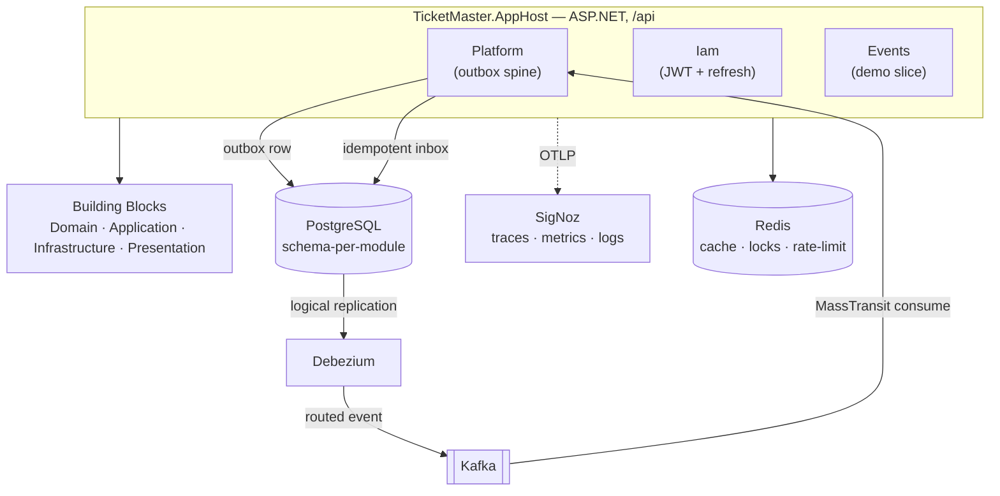

# TicketMaster

A production-shaped **.NET 10 modular-monolith template**. Not a tutorial app — a starting point you copy: a set of
product-neutral, reusable **building blocks** and three modules that show them working end to end (auth, an event-driven
spine, and a full CRUD vertical slice).

Every cross-cutting concern a real service needs is already wired and tested: a transactional outbox streamed to Kafka
via Debezium, OpenTelemetry-native observability, distributed rate limiting, L1/L2 caching, idempotent writes,
strongly-typed ids, and `Result`-based error handling — each opt-in per module, none hard-coded to this product.

---

## Why it exists

Most "clean architecture" samples stop at a to-do list. Real services need the boring, hard parts: reliable messaging
without dual-writes, correlation across async hops, backpressure, cache stampede protection, migrations that apply
themselves, and a test suite that exercises the actual infrastructure. This template ships those as **building blocks**
you assemble, and enforces the architecture so it can't rot.

- **Product-neutral** — building blocks know nothing about "tickets"; a new product reuses them as-is.
- **Opt-in** — a module gets a capability by adding a `ProjectReference`; configuration is an `Action<T>`, never a global default.
- **Enforced** — `NetArchTest` rules fail CI if a layer or module reaches somewhere it shouldn't.

---

## Architecture



**Layered building blocks** (`src/BuildingBlocks/` — see its [README](src/BuildingBlocks/README.md)): dependencies only
point inward, enforced by tests.

```
Domain/          BuildingBlocks.Domain            (shared kernel — no dependencies)
Application/     BuildingBlocks.Application        (depends on Domain only)
Infrastructure/  Persistence · Messaging.Kafka · Caching · Locking · Configuration.Secrets
Presentation/    Web · Security · Observability · HealthChecks · RateLimiting · Modularity
```

---

## What's inside

| Concern | How |
|---------|-----|
| **Reliable messaging** | Transactional **outbox** committed with the state change → **Debezium** CDC → **Kafka** (**MassTransit 8**) → idempotent **inbox** (unique-constraint dedup). No dual-write. |
| **Observability** | OpenTelemetry-native traces + metrics + logs over **OTLP** to **SigNoz** (no Serilog/fluent-bit). Correlation/causation IDs flow across HTTP and Kafka via Activity baggage. |
| **Errors** | `Result<T>`/`Option<T>` ([YC.Monad](docs/adr/0001-result-over-exceptions.md)) → **RFC 9457** problem responses at one mapping point. No exceptions for expected failures. |
| **Strongly-typed ids** | **Vogen** value objects — reflection-free EF + JSON converters ([ADR-0002](docs/adr/0002-vogen-strongly-typed-ids.md)). Mixing id types is a compile error. |
| **Computed columns** | **EF Core Projectables** — a `[Projectable]` domain expression runs in memory *and* translated to SQL, no duplicated predicate. |
| **Rate limiting** | Native `UseRateLimiter` + per-endpoint opt-ins: per-caller **burst-ban** and system-wide **adaptive admission** (AIMD), tiered per principal, Redis or local. |
| **Caching / locking** | **FusionCache** L1 (memory) + L2 (Redis, MessagePack) with stampede protection; Redis distributed lock behind a MediatR behavior. |
| **Idempotency** | `RequireIdempotency()` endpoint filter — a retry with the same `Idempotency-Key` replays the first response. |
| **Auth** | JWT with a hardened claim layout; refresh-token support; scope-based authorization; append-only audit log. |
| **Persistence** | EF Core, **schema + outbox per module**, snake_case by convention, auditing/soft-delete/domain-event interceptors, self-applying migrations. |
| **Config secrets** | AES-GCM-encrypted config values decrypted at load from `CONFIG_SECRET_KEY`. |
| **Architecture guardrails** | `NetArchTest` rules: inward-only layer dependencies + module isolation (no reaching into another module's internals). |

---

## Project layout

```
src/
  BuildingBlocks/            13 reusable blocks, grouped by layer
  Modules/
    Platform/                outbox → Debezium → Kafka → inbox spine (ping demo)
    Iam/                     JWT auth, users/roles, refresh tokens
    Events/                  demo vertical slice — the reference for a new module
  Host/TicketMaster.AppHost/ composition root: wires modules + building blocks
tests/
  UnitTests/                 domain + behavior units
  ArchitectureTests/         NetArchTest dependency & isolation rules
  IntegrationTests/          Testcontainers: real Postgres + Kafka + Debezium + Redis
infra/                       docker-compose for Postgres/Kafka/Debezium/Redis + SigNoz
docs/adr/                    architecture decision records
```

Each module is a vertical slice: `Domain/` (aggregates, Vogen ids) → `Application/` (MediatR CQRS) → `Infrastructure/`
(its DbContext) → `Host/` (thin endpoints). **`Modules/Events` is the reference** — copy it to start a new bounded context.

---

## Getting started

**Prerequisites:** .NET 10 SDK, Docker.

```bash
# 1. Infrastructure (Postgres 5432 · Kafka 9092 · Kafka-UI 8081 · Debezium 8083 · Redis 6379).
#    The Debezium connector self-registers via an init container.
docker compose -f infra/docker-compose.yml up -d

# 2. (optional) Observability — SigNoz UI + OTLP collector.
docker compose -f infra/signoz/docker-compose.yml up -d

# 3. Run the host. CONFIG_SECRET_KEY decrypts encrypted config values.
export CONFIG_SECRET_KEY=development-secret-material-change-me   # PowerShell: $env:CONFIG_SECRET_KEY="..."
dotnet run --project src/Host/TicketMaster.AppHost
```

Then open:

| URL | What |
|-----|------|
| `/scalar/v1` | Scalar API reference (OpenAPI UI) |
| `/openapi/v1.json` | OpenAPI document |
| `/health`, `/health/liveness`, `/health/readiness` | health checks |
| `http://localhost:8081` | Kafka UI |

Connection defaults live in `src/Host/TicketMaster.AppHost/appsettings.json` (Postgres `ticketmaster/tm`, Redis, Kafka,
Debezium). Migrations apply themselves on startup.

---

## Try the Events module

```bash
# Schedule an event (idempotent — the Idempotency-Key makes a retry a no-op).
curl -X POST http://localhost:5001/api/events \
  -H 'Content-Type: application/json' -H 'Idempotency-Key: 11111111-1111-1111-1111-111111111111' \
  -d '{"name":"Cup Final","venue":"Grand Arena","startsOn":"2026-08-01T18:00:00Z","capacity":5000}'

# Paged list — isLargeVenue is a [Projectable] computed in SQL (capacity >= 1000).
curl 'http://localhost:5001/api/events?page=1&pageSize=20'

# Get one (unknown id → RFC 9457 404).
curl http://localhost:5001/api/events/{id}
```

---

## Testing

```bash
dotnet test                                              # everything
dotnet test tests/TicketMaster.UnitTests                 # fast, no infra
dotnet test tests/TicketMaster.ArchitectureTests         # dependency & isolation rules
dotnet test tests/TicketMaster.IntegrationTests          # spins real Postgres+Kafka+Debezium+Redis via Testcontainers
```

Integration tests exercise the *actual* outbox → Debezium → Kafka → inbox spine and the HTTP surface — a Postgres unique
constraint can't be faked by an in-memory provider. CI ([`.github/workflows/ci.yml`](.github/workflows/ci.yml)) runs all
three suites plus a vulnerable-package audit that fails on any High/Critical advisory; Dependabot keeps deps current.

---

## Design decisions

The non-obvious *why* is recorded as [ADRs](docs/adr/): Result-over-exceptions, Vogen ids, the per-module
DbContext + outbox (including the keyed-writer rule), the layered building blocks, and the OSS library pins.
